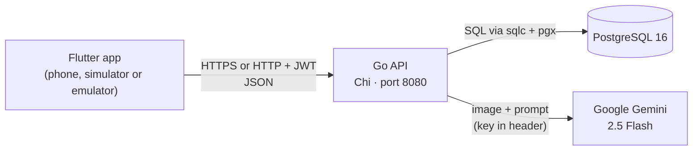
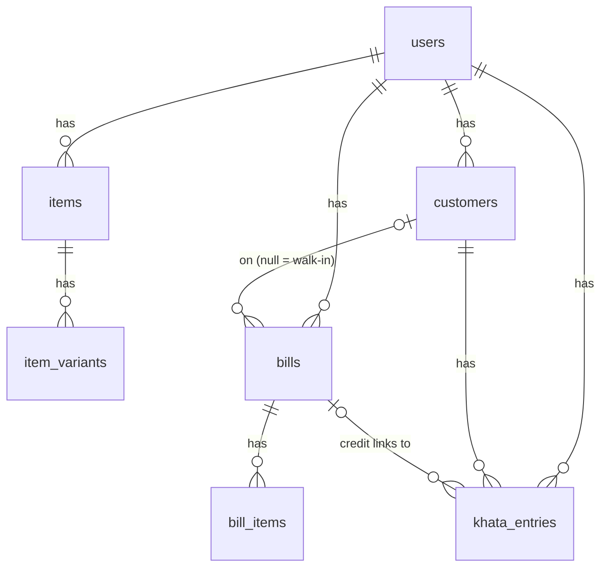
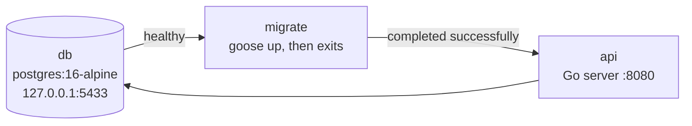

# KhataDost architecture

How the whole system fits together, as the code stands on the `revision-cleanup` branch. The design doc for each feature (written before the code) is in [`docs/features/`](features/); where this file and a feature doc disagree, this file and the code win.

---

## 1. The big picture



- **The app holds no business rules that matter.** It shows data, collects input and does advisory maths for live totals. The server validates everything, recomputes every money figure and owns all persistence.
- **The Gemini key lives only on the server.** Anything inside an APK can be extracted, so the app sends the photo to the backend and the backend calls Gemini.
- **Many shops share one database.** Each shop is a row in `users`, and every query is scoped by the `user_id` taken from the verified token, never from the request body.

---

## 2. Backend (`backend/`)

### Layers

```
HTTP request
  → Chi router            cmd/api/main.go       routes, request logging, panic recovery
  → RequireAuth           internal/middleware   checks the JWT, puts user_id in the context
  → Handler               internal/handler      decode + validate JSON, map errors to status codes
  → Service               internal/service      business rules, sentinel errors
  → Repository            internal/repository   sqlc calls, database types → plain Go types, transactions
  → sqlcgen               internal/sqlcgen      generated from db/queries/*.sql (never edited by hand)
  → PostgreSQL
```

Rules that keep the layers clean:

- Handlers never touch SQL; repositories never touch HTTP.
- A broken business rule is a **sentinel error** (a named value such as `service.ErrCustomerHasDues`). Handlers match it with `errors.Is` and pick the status code; anything unknown becomes a generic 500 with no internal detail.
- Repositories turn database errors into their own sentinels (`ErrCustomerNotFound`, `ErrDuplicatePhone`, `ErrDuplicateDefault`, ...) and wrap the rest with `fmt.Errorf("MethodName: %w", err)`.
- Repositories return plain Go structs: `NUMERIC` strings become `float64`, nullable text becomes `*string`, UUIDs become strings. No `database/sql` or sqlc types leak upward.

### Wiring

`main.go` builds every feature by hand, bottom up: repository → service → handler, then registers the routes. There is no DI framework. A few services reuse another feature's repository, read-only:

| Service | Reuses | Why |
|---|---|---|
| billing | customer repository | prove the customer belongs to this shop, and snapshot their name on the bill |
| khata | customer repository | prove the customer belongs to this shop |
| scan | inventory repository | the shop's items are the pool that detections are matched against |

### Startup and shutdown

- Settings come from environment variables. `backend/.env` is loaded if it exists (local `go run`); in Docker the variables come from `docker-compose.yml` and there is no `.env` in the image.
- The server stops at startup if `DATABASE_URL` or `JWT_SECRET` is missing, and warns if `ACCESS_CODE` or `GEMINI_API_KEY` is empty. `PORT` defaults to 8080.
- `http.Server` timeouts: 10 s for headers, 60 s to read and write (enough for a ~10 MB scan photo and the 30 s Gemini call), 120 s idle.
- On Ctrl+C or SIGTERM (what `docker compose down` sends) the server stops accepting requests and gives in-flight ones 10 s to finish.

### Auth

- **Register** needs the shop's details plus `access_code`, compared with `ACCESS_CODE`, so only invited shops can sign up. The password is hashed with bcrypt. A duplicate email is 409; any other failure is 500.
- **Login** compares the bcrypt hash and returns a JWT: HS256, signed with `JWT_SECRET`, claims `sub` (user id), `iat`, `exp` (30 days).
- **RequireAuth** accepts only `Authorization: Bearer <token>`, rejects any signing method other than HMAC, checks expiry, parses `sub` as a UUID and stores it in the request context under an unexported key type, so no other package can collide with it.

### Data model (goose migrations `db/migrations/001` to `007`)



| Table | Key points |
|---|---|
| `users` | One row per shop. `email` unique, `password` is a bcrypt hash |
| `customers` | `UNIQUE (user_id, phone)`. No balance column: `has_dues` is computed from the ledger in the queries |
| `items` | `pricing_type` is `unit` (sold by count, has variants) or `loose` (sold by measure, has `rate` + `unit`, no variants). `UNIQUE (user_id, name)` |
| `item_variants` | `label`, `price`, `is_default`. A partial unique index allows only one default per item |
| `bills` | `amount` is the bill total (the dashboard sums it), `amount_paid` is what was paid at settle, `customer_id` is null for a walk-in, `customer_name` is a snapshot |
| `bill_items` | Snapshot of each line: `name`, `quantity` (3 decimals, so 0.750 kg works), `unit_price`, `line_total`, plus `line_no` for the order the lines were added in. `item_id` and `variant_id` only record where a line came from and become null if that inventory row is deleted |
| `khata_entries` | Append-only ledger. `type` is `credit` or `payment`; a credit links to its bill |

Money is `NUMERIC(12,2)` in Postgres. Ids are random UUIDs (`gen_random_uuid()`). Migrations are never edited after they ship: the `bills` stub from 002 was extended by `ALTER TABLE` in 005, and 006 dropped the old hand-set `has_dues` column once the ledger could compute it.

### Transactions

Two writes touch several rows and must succeed or fail together:

| Operation | Rows written |
|---|---|
| Create an item (`inventory_repository.go`) | the item, then each variant |
| Settle a bill (`billing_repository.go`) | the bill, each line, then any khata entries |

The pattern in both: `tx := db.BeginTxx(...)`, `defer tx.Rollback()` (undoes everything on any early return and does nothing after a commit), `qtx := sqlcgen.New(tx)` so every query runs inside the transaction, then `tx.Commit()`.

### Billing and the khata rule

The settle rules live in `billing_service.go`:

1. Every line needs a name, a positive quantity and a non-negative price. The server recomputes each line total and the bill total, rounding to paise at every step; it never trusts totals from the app. It does accept the unit price, because the shopkeeper may edit any price.
2. "Paying now" defaults to the bill total.
3. A walk-in must pay exactly the total (409 otherwise): there is no ledger to owe against.
4. For a customer, `khataEntriesFor(total, paid)` decides the ledger rows. It is a pure function with a unit test:
   - paid in full → nothing (a settled bill has no place in the dues book)
   - otherwise → a `credit` for the whole bill, linked to it, plus a `payment` for whatever was paid now
5. The repository writes the bill, the lines and exactly those entries in one transaction. It makes no decisions of its own.

The balance is always `sum(credit) − sum(payment)`, computed by `GetCustomerBalance` and inside the customer queries. Paying more than the total is allowed; the extra pays down older dues, and a negative balance means the shop owes the customer.

**Ordering:** a bill's credit and payment are written in one transaction, so they share the same `created_at` (Postgres fixes `NOW()` for the whole transaction), and random UUIDs say nothing about order. `ListKhataEntries` therefore sorts by `created_at`, then credit before payment, then id. Bill lines sort by `line_no` for the same reason.

### Money

`float64` in Go and `double` in Dart, with `round2` (half away from zero, the same in both languages) at every boundary and a half-paisa tolerance (`moneyEqual`) instead of `==`. At real financial scale, integer paise or a decimal type would be the safer choice, because a float can't store 0.1 exactly.

### Dashboard

`GetTodaySales` sums today's bills where "today" is the shop's day in India: it finds midnight IST and keeps bills in `[midnight, midnight + 1 day)`. That works whatever time zone the database session uses (Neon and the Docker image use UTC) and keeps the `(user_id, created_at)` index usable. The 3 most recent bills come from the same index.

### Scan (`internal/gemini`, `scan_service.go`, `scan_matcher.go`)

```
POST /v1/scan {image_base64, mime_type}
  1. VALIDATE  handler: jpeg/png/webp, body ≤ 12 MB, decoded image ≤ 7 MB
  2. DETECT    gemini.Client.Detect: image + short prompt + response schema → []Detection
  3. GATE      confidence < 0.8 → dropped silently (the shopkeeper adds it by hand)
  4. MATCH     MatchDetections: pure function against this shop's unit items
  5. RESPOND   matches (full inventory cards at their default variant) + unmatched labels
```

- The Gemini client sits behind a one-method interface, so tests swap in a fake server or a stub.
- The response schema forces Gemini to answer with a JSON array, so no text scraping is needed.
- Matching is by **brand words first**, because a test run showed Gemini's `name` field is unreliable; name words are only a fallback. The most shared words win, and ties go alphabetically, so the same input always gives the same output. Text is normalised ("Lay's" matches "Lays", "Parle-G" matches "Parle G").
- Failures degrade politely: one quick retry on a 429, then 429 "try again in a minute"; a 30 s timeout gives 504; anything else gives 502. Without a key the server still starts and only scan answers 502.
- Scans are never stored. Only the settled bill is.
- The free tier allows about 10 requests a minute and 250 a day per Google Cloud project, shared by every shop.

### Status codes used

| Code | When |
|---|---|
| 400 | Bad JSON, missing fields, bad UUID, broken business shape (for example a unit item without a default), duplicate customer phone |
| 401 | Missing or invalid token, wrong password |
| 403 | Wrong access code at register |
| 404 | Not found, or belongs to another shop (the two look the same on purpose) |
| 409 | Business conflict: email taken, customer has dues, walk-in paying short, second default variant, duplicate item name, variant on a loose item |
| 429 / 502 / 504 | Scan: Gemini quota, Gemini failure, Gemini timeout |

---

## 3. Running it (`docker-compose.yml`)



- One image (`backend/Dockerfile`) holds both the `api` binary and `goose`. The build stage compiles both with CGO off; the runtime stage is Alpine with CA certificates, running as a non-root user.
- Secrets come from `backend/.env` (gitignored). Compose overrides `DATABASE_URL` so the API reaches the `db` container.
- Postgres data lives in the `pgdata` volume. `docker compose down -v` deletes it.
- The Flutter app runs outside Docker: `localhost:8080` from the iOS simulator, `10.0.2.2:8080` from the Android emulator, the computer's Wi-Fi IP from a real phone (`--dart-define=API_BASE_URL=...`).

---

## 4. Flutter app (`app/`)

### Feature-first clean architecture

```
lib/
├── main.dart                    preserve native splash → setupDependencies() → runApp
├── core/
│   ├── constants/               AppConstants (JWT key, backend address)
│   ├── di/injection.dart        GetIt: every datasource, repository, bloc, router
│   ├── network/                 DioClient (JWT + 401 handling), ApiException, error mapping
│   ├── storage/                 SecureStorageService (JWT + user JSON)
│   ├── router/app_router.dart   GoRouter, redirect guard, StatefulShellRoute
│   ├── navigation/              AppRoutes (every path) + NavigationCubit (every navigation)
│   ├── shell/                   floating glass bottom bar, centre scan button, settings gear
│   ├── theme/                   design tokens (violet #7C3AED) and ThemeData
│   └── widgets/                 snackbar, confirm dialog, empty state, skeletons
└── features/
    ├── auth/  dashboard/  customers/  inventory/  bills/  khata/  settings/
```

Inside each feature:

```
feature/
├── domain/          entities (plain Dart), abstract repository, pure maths (bill_math, khata_math)
├── data/            models (fromJson), datasources (mock + remote), repository implementation
└── presentation/    bloc (events, state, bloc) and pages
```

### State: one state class per bloc

Each bloc has one state class with a `status` enum and `copyWith` (plus `clear...` flags), not a family of subclasses. Events are plain triggers. Derived values are computed in the bloc and emitted together with their inputs, so the UI never sees a half-updated state: the customer list filtered by the search index, the khata running balances, the bill totals.

### Dependency injection

`injection.dart` registers singletons in order: secure storage → `DioClient` → datasources → repositories → blocs → router → `NavigationCubit`. Each datasource is registered against its abstract type, and every feature keeps both a mock and a real version in the code: switching is commenting one line. Each feature was built against its mock first, and the Go backend was then written to match that exact contract.

### Networking

One `DioClient` for the whole app. A request interceptor adds `Authorization: Bearer <token>` from secure storage. If a request that carried a token comes back 401, `onUnauthorized` dispatches `LogoutRequested` to the AuthBloc, which clears storage; the router's redirect then sends the user to the welcome screen. Login and register 401s don't trigger this, because they carry no token. Remote datasources turn `DioException` into `ApiException`, keeping the server's `error` message when there is one so pages can show it inline.

The backend address is `AppConstants.baseUrl`: `--dart-define=API_BASE_URL` if given, otherwise `10.0.2.2:8080` on Android and `localhost:8080` everywhere else.

### Navigation

- **Redirect guard** (declarative): driven by the AuthBloc stream. No token → only splash, welcome, login and register are reachable; logged in → the auth pages redirect to the dashboard.
- **Shell:** `StatefulShellRoute.indexedStack`, so each tab keeps its own back stack: Home, Bills, Inventory, Customers. The centre button opens a new bill in scan mode; the gear opens Settings.
- **NavigationCubit** (imperative): pages never call `context.go` or `context.push` themselves; they call cubit methods, and every path lives in `AppRoutes`.

Main routes: `/home/dashboard`, `/home/bills`, `/home/bills/new` (`?scan=1` starts with the camera), `/home/bills/new/settle`, `/home/inventory` (plus `/add`, `/:id`, `/:id/edit`), `/home/customers` (plus `/add`, `/:id`, `/:id/edit`, `/:id/khata`), `/settings`, `/settings/change-password`.

### Auth on a cold start

The JWT and a JSON copy of the user are stored with flutter_secure_storage (encrypted shared preferences on Android). On launch, `AppStarted` restores both **without a network call**, so the app opens even when the server is down and the dashboard greeting has a name on the first frame. A dead token is caught by the first protected request (401 → logout). Settings fetches `/v1/me` fresh when it opens.

### Billing in the app

- One `BillBuilderBloc` holds the draft bill for the whole app, so the scan button and the Bills tab work on the same draft.
- Draft lines are a sealed class: a unit line (swipe between variants; a typed price overrides until the next swipe), a loose line (quantity × rate) and a free-typed line. Each one turns into the flat `{item_id?, variant_id?, name, quantity, unit_price}` shape the API takes.
- `bill_math.dart` mirrors the server's rounding so the live total matches what the server will store. The server's figures stay the source of truth.
- Variant lookups use plain loops, not `firstWhere(orElse: ...)`: lists parsed from JSON are really `List<ItemVariantModel>`, and Dart's covariant generics make an `orElse` closure typed for the parent class throw a TypeError at runtime.

### Khata in the app

`KhataBloc` has three separate statuses: loading the ledger, recording a payment (with inline errors in the sheet) and loading a bill's items for the sheet behind a credit row. `khata_math.runningBalances` walks the oldest-first entries from the server; the page then shows them newest first. After a payment the page asks the CustomersBloc to reload, so `has_dues` updates on the Customers tab.

### Customer and item search

Fully in the app (no search endpoint yet). `CustomerSearchIndex` splits every name into lowercase words and keeps a sorted list of (word, id) pairs, an inverted index. A query prefix `p` uses binary search (`lowerBound`) twice to find the range `[p, p')`, where `p'` is `p` with its last character moved up by one, so every word starting with `p` falls inside the range. That finds "Suresh Sen" for "sen". Multi-word queries must match every word. Inventory reuses the same approach.

---

## 5. Testing

| What | Where |
|---|---|
| Gemini client (fake HTTP server: success, retry, timeouts, bad replies, missing key, no key in errors) | `internal/gemini/gemini_test.go` |
| Scan handler (stub service: 401, 400s, size limit, error mapping) | `internal/handler/scan_handler_test.go` |
| Matcher (gate, brand first, scoring, pool, labels) | `internal/service/scan_matcher_test.go` |
| Khata rule of a bill | `internal/service/billing_service_test.go` |
| Every endpoint, including error cases | `bruno/KhataDost API/` |

There are no Flutter tests in the repo yet, and the other backend features have no Go tests.

---

## 6. Known limits

- Money is `float64` with careful rounding, not integer paise.
- Search runs in the app over the full lists; fine for one shop's customers, but it needs a server search and pagination at scale.
- One Gemini key and quota for every shop.
- Setting a new default variant needs two calls (unset the old one first); a single call answers 409.
- No refresh tokens: a token lasts 30 days, then the user logs in again.
- No payment method on a bill (cash and UPI aren't told apart).
